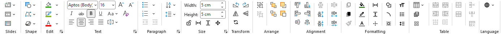

# All-in-one

Everything you reach for in PowerPoint, in a single ribbon tab, plus a handful of tools PowerPoint doesn't have.

All-in-one adds a tab at the start of your ribbon that gathers the commands you use most: slides, shapes, text, sizing, alignment, tables and more. You stop hopping between Home, Insert, Design and Shape Format, and you get a few time-savers on top.



## Install

You need Windows and the desktop version of PowerPoint.

Run this in PowerShell:

```powershell
irm https://github.com/etoome/All-in-one/releases/latest/download/Install.ps1 | iex
```

Restart PowerPoint. The **All-in-one** tab appears at the start of the ribbon.

The add-in checks GitHub once a day for updates. When one is available, an **Update** group appears at the start of the tab. Click **Update to vX.Y.Z**, confirm, then restart PowerPoint. To update manually or if the in-app download is blocked, run the same PowerShell command again.

<details>
<summary>Uninstall</summary>

Run this in PowerShell:

```powershell
iex "& { $(irm https://github.com/etoome/All-in-one/releases/latest/download/Install.ps1) } -Uninstall"
```

Restart PowerPoint and the tab is gone.

</details>

## For developers

Building from source or contributing? See [CONTRIBUTING.md](CONTRIBUTING.md).

## License

[MIT](LICENSE). Third-party icon attributions are in [THIRD_PARTY_NOTICES.md](THIRD_PARTY_NOTICES.md).
