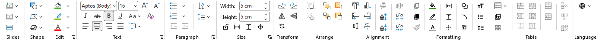

# All-in-one

Everything you reach for in PowerPoint, in a single ribbon tab, plus a handful of tools PowerPoint doesn't have.

All-in-one adds a tab at the start of your ribbon that gathers the commands you use most: slides, shapes, text, sizing, alignment, tables and more. You stop hopping between Home, Insert, Design and Shape Format, and you get a few time-savers on top.

## Install

You need Windows and the desktop version of PowerPoint.

1. Download `All-in-one-vX.Y.Z.zip` from the [latest release](https://github.com/etoome/All-in-one/releases/latest).
2. Double-click the zip to open it in File Explorer, then double-click **Install.cmd** to install the add-in (Windows will extract it automatically).
3. If Windows shows a security warning, choose **Run**. Restart PowerPoint when the installer finishes. The **All-in-one** tab appears at the start of the ribbon.

The installer works for your user only and does not need administrator rights.

The add-in checks GitHub once a day for new releases. When one is available, an **Update** group appears at the start of the tab.

Uninstall

Run `Install.cmd -Uninstall` from the extracted folder, then restart PowerPoint and the tab is gone.

## For developers

Building from source or contributing? See [CONTRIBUTING.md](CONTRIBUTING.md).

## License

[MIT](LICENSE). Third-party icon attributions are in [THIRD_PARTY_NOTICES.md](THIRD_PARTY_NOTICES.md).
